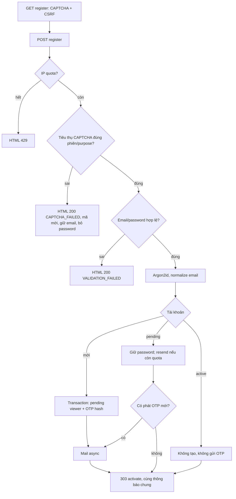
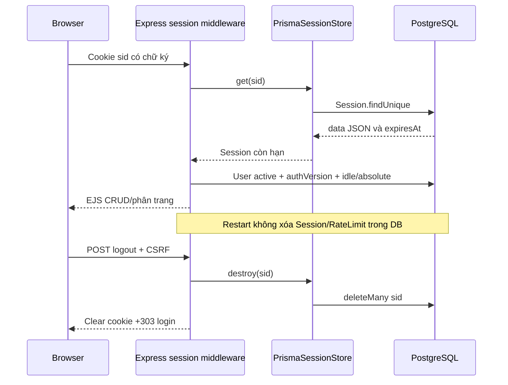
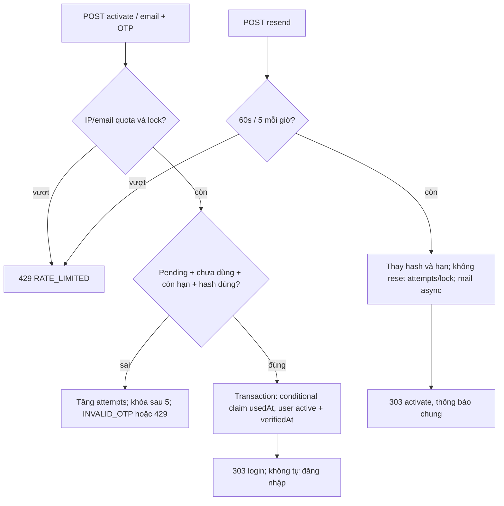
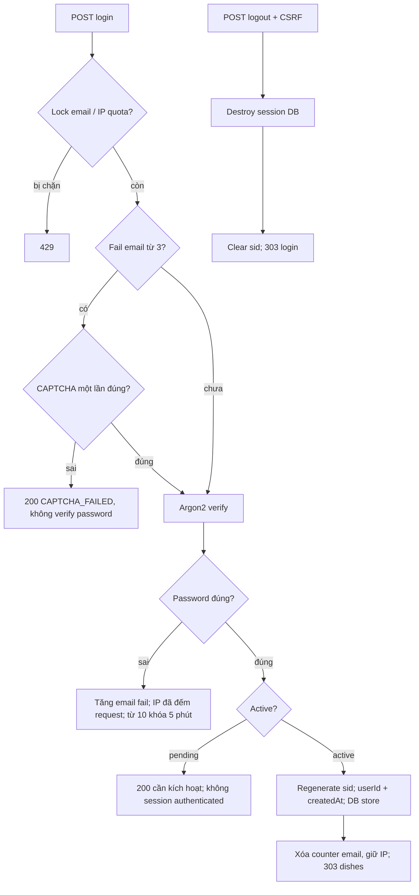
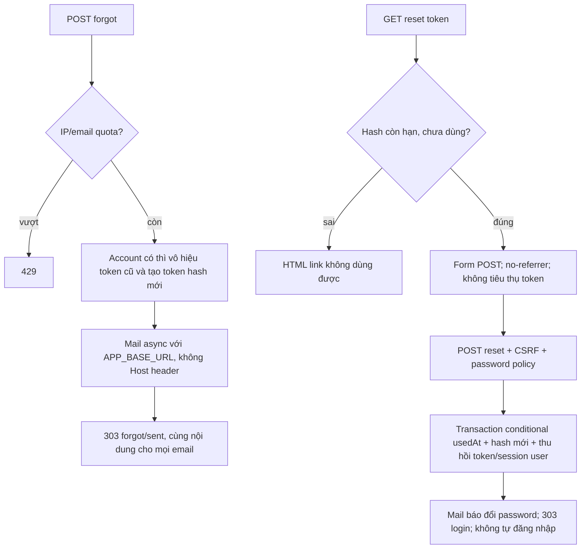

# Sơ đồ tham khảo luồng SSR Block8

Các sơ đồ là bản tham khảo đúng luồng mã để nhóm tự vẽ lại và giải thích theo slide62–63; không tuyên bố bản agent vẽ là sản phẩm nhóm tự vẽ. Tất cả màn hình là EJS, mọi ghi nghiệp vụ từ người dùng là POST có CSRF và kiểm Origin/Fetch Metadata như auth-policy.

Vấn đáp ngắn: cookie chỉ giữ SID có chữ ký, DB mới giữ session; xóa cookie không tự xóa row DB. CAPTCHA tăng chi phí bot nhưng không thay counter/khóa. Pending bị chặn trước regenerate ở login và ở guard. Reset token chỉ lưu hash; POST reset xóa mọi session user. GET reset không claim token; POST native với no-referrer dùng ngoại lệ Origin:null + same-origin Fetch Metadata + CSRF. Public chỉ các trang auth/static; toàn CRUD phải login. Chi tiết bằng chứng tại VERIFY và HANDOFF.

